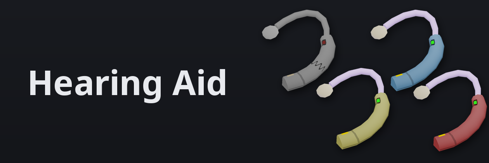
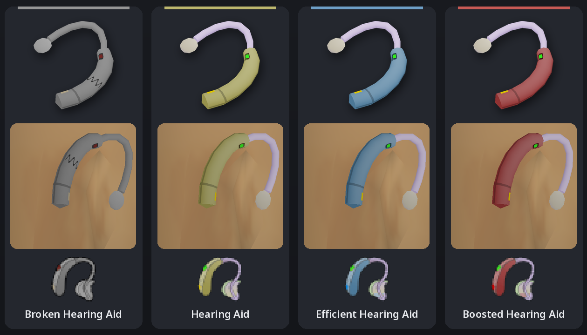
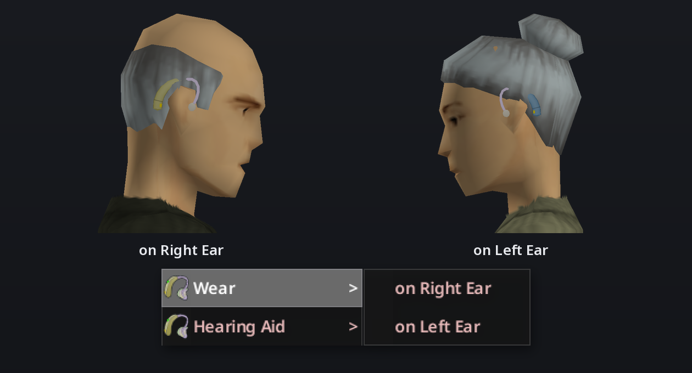
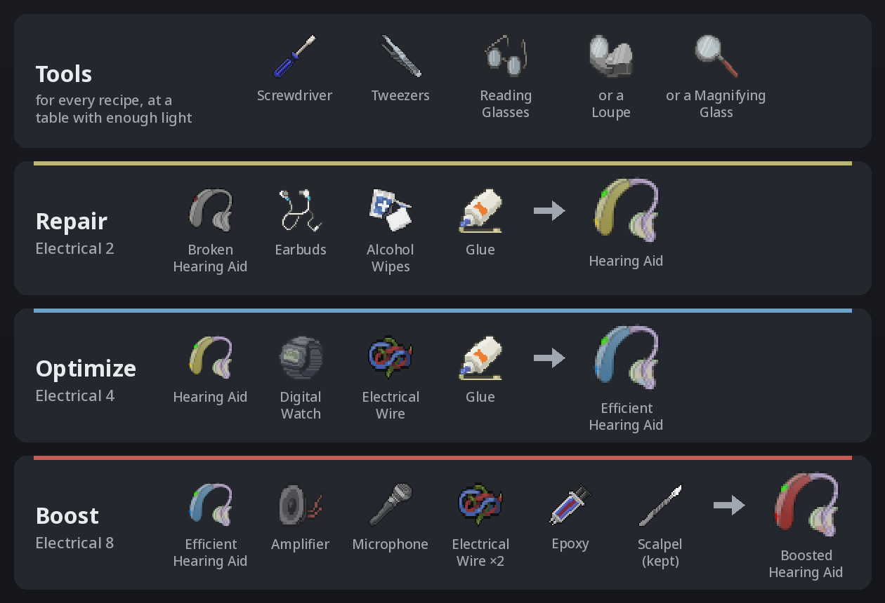
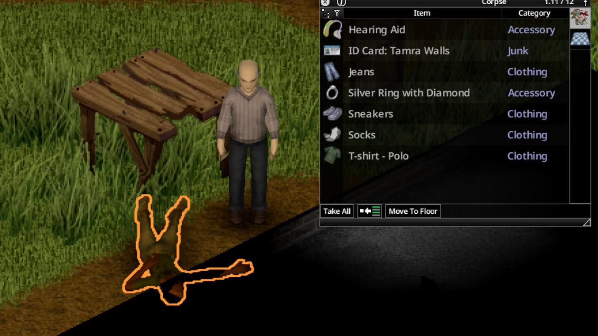

# 

Take Deaf or Hard of Hearing for the trait points, then earn your hearing back. Most hearing aids you find are broken. Repair one and a Hard of Hearing survivor hears normally again; upgrade it twice and even a Deaf one does, while anyone else gets Keen Hearing. Every working hearing aid runs on batteries, so hearing well is something you keep paying for.

**Build 42.21 or newer.** Single player and multiplayer. Fine to add to a save in progress.

## From broken to boosted

| Model | Hard of Hearing becomes | Deaf becomes | A battery lasts | How you get one |
|---|---|---|---|---|
| Broken Hearing Aid | no change | no change | | Most of the ones you find |
| Hearing Aid | normal hearing | Hard of Hearing | 2 days | Find one, or repair a broken one |
| Efficient Hearing Aid | normal hearing | Hard of Hearing | 6 days | A lucky find, or optimize a hearing aid |
| Boosted Hearing Aid | Keen Hearing | normal hearing | 4 days | Boost an efficient one |

## Wearing one

1. Right-click a working hearing aid and choose **Add Battery**. It takes a flashlight's Battery.
2. Choose **Wear**, then **on Right Ear** or **on Left Ear**.
3. Choose **Turn On**.

The battery drains only while it's on your ear and switched on, so switch it off when you don't need to hear.

## Crafting

Everyone knows the recipes, but each needs a table, enough light, a screwdriver, tweezers, and reading glasses, a loupe or a magnifying glass to see by. Take the hearing aid off your ear first. Glue and epoxy cost one use each, Cotton Balls Doused in Alcohol stand in for Alcohol Wipes, and the new hearing aid keeps the old one's battery.

A repair takes things any house has. For a boost, take the amplifier out of a speaker and go looking for a microphone where people played music. **Dismantle Hearing Aid** turns a spare into scrap electronics and gives its battery back.

## Finding one

Most hearing aids in Knox County are still in their owners' ears, and the owners won't mind if you take them. Search the old folks first, wherever retirees would have gathered, and hospital patients after them. Off the ear, hospitals hold the most, and houses keep a few where someone would leave theirs at night. Pharmacies and electronics stores won't have any.

## Sandbox options

- **Battery Life**: how long a battery lasts in each model.
- **Electrical Level**: the skill each recipe needs. 0 drops the requirement.
- **Handle Deafness**: whether hearing aids help a Deaf survivor, and how much.

Loot rates, the chance a found one still holds a battery, and **Enable Boosted Hearing Aids** are on the **Hearing Aid** page of the sandbox options.

## Questions

- **Can I remove it from a save?** Take your hearing aid off first. While one works, your hearing trait is the one it gives you, and without the mod nothing would change it back. Hearing aids in the world disappear with the mod.
- **Does it work in my language?** Every text the mod shows is translated into each language the game offers, in the game's own words for traits, items and skills.

## Credits

By Caleb Fenton. The source is on [GitHub](https://github.com/CalebFenton/PZ_HearingAid).

## Install

Subscribe on the [Steam Workshop page](https://steamcommunity.com/sharedfiles/filedetails/?id=2931424725) and enable **Hearing Aid** in the mod list.

## Development

Clone the repository to `~/Zomboid/Workshop/HearingAid`. With Steam running, the game lists it as a local mod. Read [DEVELOPMENT.md](DEVELOPMENT.md) for the commands that test the mod and rebuild its art, and for the Build 42 behavior it depends on. Rebuilding the art needs [Blender](https://www.blender.org/) and [uv](https://docs.astral.sh/uv/).
